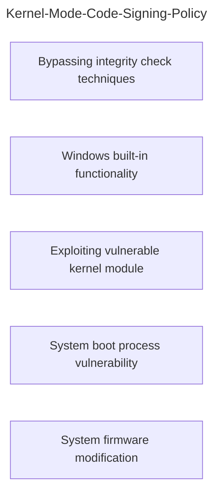

> [!Note] This note is heavily inspired by the awesome book [Rootkits and Bootkits](https://bootkits.io/) written by Alex Matrosov, Eugene Rodionov, and Sergey Bratus! You should give it a read!
# Kernel-Mode Code Signing Policy
Introduced with Windows Vista, the Kernel-Mode Code Signing Policy created a new challenge for bootkit developers. Now, in order to execute kernel-mode drivers you would have to have a valid digital signature. This meant that unsigned malicious kernel-mode drivers would not load.

Now, techniques to bypass this policy can be divided into four different categories:

# Secure Boot